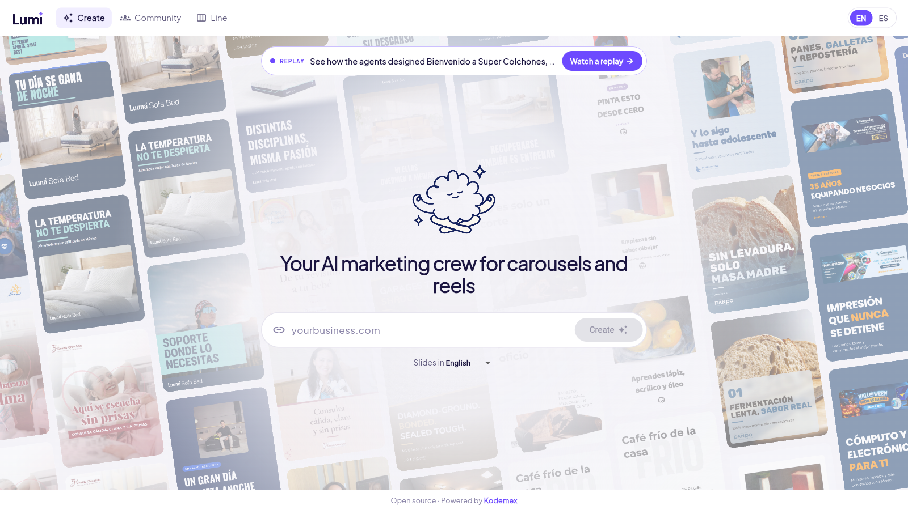
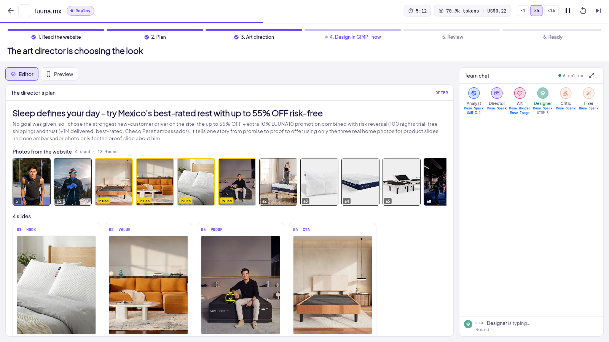
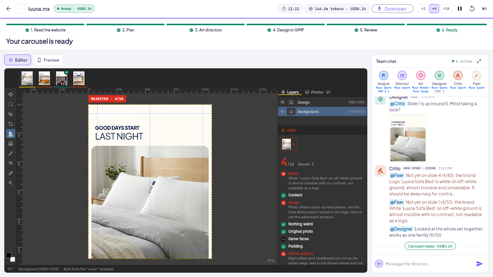

# Lumi · carousel agent

**The professional alternative to AI image generators, for businesses that care about every detail.**

AI image generators invent what a business sells: the wrong product, faces that aren't theirs, text nobody can read. Lumi doesn't generate the image. A crew of agents on Meta's models makes the decisions a designer would and edits the business's real photos live, layer by layer, into an on-brand Instagram/Facebook carousel, checked by its own critic and ready to post.

The business gives its website and a language. Nothing else: the run is automatic. The agents work the way an agency's production team does: they read the brand, plan with the real material there is, pick a design from the agency's gallery, draw it, check their own work, take the owner's revisions and deliver.

The agents don't generate the slides as images. They use the business's **real photos and logo**, find the subject with **SAM 3.1** so it is never cut or covered, and build every slide as real layers in **GIMP**. Code measures what a model can't be trusted with (geometry, contrast, time), and models judge what code can't (brand, taste, meaning).

Built in nine days for the **Meta Global AI Developer Hackathon 2026**.

## See it

**Create**: the business gives a website and the language of the slides. Behind it, carousels the agents made for other businesses.



**Live**: the run as it happens. The director's plan uses only the website's real photos, and the six agents talk in the team chat.



**Review**: the slide in GIMP with its layers. The critic rejects it (4/10: the logo is unreadable, the photo isn't the product, the bed is cut off) and sends it to the fixer; the carousel only ships when the critic approves.



## The flow

| Step | Agent | Model | What happens |
| --- | --- | --- | --- |
| 1. Intake | Analyst | Muse Spark (vision) | Reads the website as a visitor sees it (headless Edge, desktop and phone), downloads every image at full size and sorts it: logo, products, photos, banners. Photos with the product cut by their own edge are marked unusable. A website it can't read in 4 minutes, a social profile behind a login, or one without a usable photo stops the run: it never goes on blind. |
| 2. Strategy | Director | Muse Spark | Picks the format for the business (catalog, proof, benefits, how it works, offer) and plans the slides and the caption from real facts only. A store always shows its product. From Create, the owner can change the words, the photos or the slides before the design starts. |
| 3. Style | Style picker | Muse Spark (vision) | Picks one design from the agency's gallery for this business and its call to action, with what the owner liked before. Every slide follows that one reference. |
| 4. Art direction | Art director | Muse Wonder (vision) | Maps the reference to the brand: colors, fonts, logo treatment, and a decor kit (backdrop, texture, element) that **Muse Image** generates once. |
| 5. Production | HTML designer + GIMP | Muse Spark + SAM 3.1 | Each 1080×1350 slide recreates the reference as HTML with the brand's photo, logo, words and colors; a fit script shrinks any text that overflows or overlaps, headless Edge renders it and it goes into GIMP over MCP as a layer. Slide 2 is the master; the others follow it. Without a reference, GIMP templates draw the slides. |
| 6. QA | Set critic, lint, fixer | Muse Spark (vision) + code | The finished carousel is judged against its reference on one contact sheet. If it follows the reference, only the slides the critic names are redrawn with its notes. If it doesn't, the agent tries another reference once and **keeps whichever carousel scored better**. Template slides go through the geometry lint, a yes/no checklist and fixes from a fixed contract (`smaller_headline`, `text_above_photo`, `another_photo`…); the best round is kept, not the last. |
| 7. Client revision | Owner → fixer | Muse Spark | The owner changes a text or a photo, or asks in plain words ("bigger headline"), even while the rest of the carousel is still being made. The slide is rebuilt and checked. |
| 8. Delivery | System | | The ready window: download the ZIP (PNGs, editable XCFs and the caption), post it from [Lumi](https://lumi.kodemex.com.mx), or ask for the 30 s reel. |

```
website + language
      │
      ▼
  Analyst ──► Director ──► Style picker ──► Art director ──► decor kit (Muse Image)
                 ▲              (gallery)         │
          owner edits the plan                    ▼   master slide first, then the rest
                                 SAM 3.1 ──► HTML designer ──► Edge render ──► GIMP layer
                                                  ▲                               │
                                                  └── redraw the slides named ◄── set critic
                                                       or try another reference,  (vs. the reference)
                                                       keep the better carousel
                                                  │
                               owner revisions ───┤
                                                  ▼
                                   ZIP: carousel + caption  ·  post from Lumi  ·  reel
```

**A run never stalls.** A model call that hangs is cut at 90 s and tried once more. Each carousel has a 10-minute budget: past half of it there are no more critic rounds, and past 70% it is delivered as it is. Every limit can be set in `server/.env`.

## In the app

- **Create**: a website and a language. The room shows the agents working live: the plan, the tool calls, the reviews, the slides as they're approved, and a run timer. Tap an agent to see what it does and which technology it uses. If the agents are busy, the website joins the line.
- **Room**: the run in progress, with its steps and the team chat between the agents.
- **Line**: the community's queue as a board (in line, in progress, done). Anyone can add a website, and the agents make one carousel after another.
- **Community**: every carousel made, as a Meta feed (feed and grid), with the research behind each one and 👍/👎 votes.
- **Queue** (`?view=queue`): batches of websites, measured, for tuning the agents.
- English and Spanish, switched from the header.

## It learns what the owner likes

👍/👎 on a carousel or a slide is stored with the features of what was voted: reference, composition, personality, fonts, logo, layout, hook and energy. Each feature value keeps a Beta posterior. The style picker and the art director read what the owner clearly liked or disliked, and code picks replacements by **Thompson sampling**. A 👎 asks what's wrong. Those words go to the critic before it approves the next slides, and each vote keeps what the critic said at the time. **Your taste** shows how often the critic agrees with the owner. A variety check keeps brands from looking alike.

## The reference gallery

The style picker chooses from a gallery of designs the agency likes. **The gallery is not in this repo**: it holds other brands' ads, which are not ours to share. Only the style read from each one (its recipe) is used, never its words, brand or image. Without a gallery, the GIMP templates draw every slide.

Add your own designs (PNG, JPG or WebP) with the server running:

```bash
cd server
node scripts/add-references.mjs path/to/your/designs
```

Each one is read once by a vision model, which stores its composition, ground, type, layout and color zones, and it's kept in `server/runs/library/reference/`. A finished carousel can also join the gallery.

## The reel

The server can cut the approved layers into a 30 s reel with **HyperFrames**: a reel director picks the scenes (photo wall, marquee, product drop, deck, grid, stack list), the cuts land on the music's beat, code fits the reading time (`fitBeats`) and a reel critic reviews the frames. A reel takes about as long as a carousel, so it's made only when the owner asks for it from the ready window. The room shows its own steps: plan the shots, music, render, critic review. `REELS=1` makes one after every carousel instead. The rules are in [docs/REEL_STANDARD.md](docs/REEL_STANDARD.md).

## Many websites, measured

The **Queue** runs a list of websites one after another, in named batches. Each run is measured in code: the set score, slides approved and approved on the first pass, rounds per slide, which critic checks and lint problems failed, cost and minutes. A batch's report (`server/runs/batches/<batch>.md`) says how the agents did, and **Run again** puts the same websites in a new batch after a change, to compare. A saved list (`server/lists/<name>.txt`, one website per line, kept out of git) shows up as **Start 1–10**, **Start 11–20**… The failure history (`FAILURES.md`) keeps every kind of failure across batches, with what fixed it before, from [docs/LESSONS.md](docs/LESSONS.md).

## What is code and what is a model

| Decided by code | Decided by a model |
| --- | --- |
| Slide geometry (`src/lint.ts`): overlaps, margins, faces, product whole in its card | Brand fit, content, aesthetics (critic) |
| Text that overflows or overlaps in an HTML slide (the fit script in `src/html_slide.ts`) | How to recreate the reference with this brand (HTML designer) |
| Keeping the better carousel when a reference is switched (`src/orchestrator.ts`) | Whether the carousel follows its reference, and which slides to redraw (set critic) |
| The fix contract (`src/fixes.ts`): only actions the templates can take | Which fix a failed check needs (fixer) |
| Text contrast (WCAG 4.5:1) and decor strength | The visual system and the decor prompts (art director) |
| SAM 3.1 one-bit mask decoding (`src/sam_mask.ts`), written from Meta's wire format | What the subject of each photo is |
| Time budget, model timeouts, the reading gate | Which reference fits the business (style picker) |
| Thompson sampling over the owner's votes (`src/taste.ts`) | Reading the taste summary into the next design |

## Stack

- `server/`: Node 24 + TypeScript. The agents call the Meta Model API (OpenAI-compatible Chat Completions with tool calling and image input): `muse-spark-1.3`, `muse-wonder-1.0` (falls back to Spark), `muse-image-1.0` and `sam-3.1`. The server drives GIMP as an MCP client, renders the HTML slides and reads websites with headless Edge or Chrome, and renders reels with HyperFrames (`npx hyperframes`, needs ffmpeg). It streams every step to the app with Server-Sent Events and keeps the feed, the line and the votes in SQLite (`node:sqlite`).
- `app/`: Flutter web, served by the server.
- GIMP 3.2 with [gimp-mcp](https://github.com/maorcc/gimp-mcp) (GPLv3), run headless (`gimp-console`) by the server. Not included in this repo.
- Music: the [Mixkit](https://mixkit.co/license/#musicFree) free stock catalog (`server/data/music.json`, built by `server/scripts/build-music-catalog.mjs`).

## Run it

You need:

- Node 24
- Flutter 3.38
- ffmpeg
- a Chromium browser (Edge or Chrome)
- GIMP 3.2 with the gimp-mcp plugin and its Python server
- a Meta Model API key

```bash
cd app && flutter build web && cd ..   # once, and after changing the app
cd server
cp .env.example .env                   # MODEL_API_KEY, gimp-mcp paths, GIMP_CONSOLE
npm install
npm run check-gimp                     # optional: draws a test slide in headless GIMP
npm start                              # open http://localhost:8787
```

Every setting is explained in [server/.env.example](server/.env.example): models, GIMP, browser, time budget, HTML slides and reels.

To watch the agents work in the GIMP window, leave `GIMP_CONSOLE` empty, open GIMP and run **Tools › MCP › Start MCP Server**.

To develop the app with hot reload, run `flutter run -d chrome --dart-define=API_URL=http://localhost:8787`.

## Tests

```bash
cd server && npm run typecheck && npm test
cd app && flutter analyze
```

The tests never call the model API or GIMP. They cover the code that decides:

- the geometry lint and the fix contract;
- the SAM mask decoder, against a reference encoder written from the same spec;
- product first for stores;
- reel timing;
- taste learning;
- run metrics;
- color contrast.

CI runs them on every pull request.

## Docs

- [docs/SCOPE.md](docs/SCOPE.md): the agency flow, what is in and out of scope, and what "done" means for the demo.
- [docs/REEL_STANDARD.md](docs/REEL_STANDARD.md): the motion rules of the reel.
- [docs/LESSONS.md](docs/LESSONS.md): what fixed each kind of failure.
- [CONTRIBUTING.md](CONTRIBUTING.md): branches, atomic commits and pull requests.

## License

Open source under the [MIT License](LICENSE). The Lumi name, logo and mascot are the product's brand and are not covered by the license. Websites, photos and logos the agents read belong to their owners.

Made by Eduardo Romero at [Kodemex](https://kodemex.com.mx): web, apps and paid ads for businesses. Need something like this for your company? [kodemex.com.mx](https://kodemex.com.mx)
